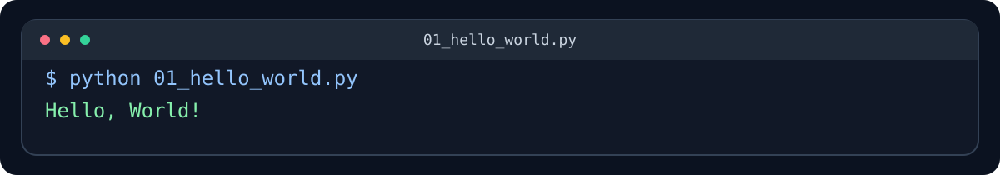
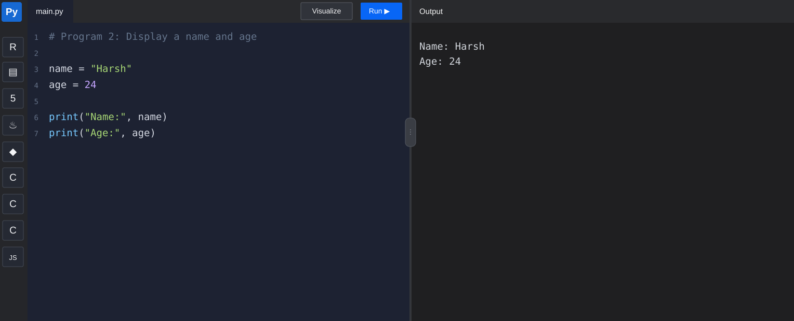
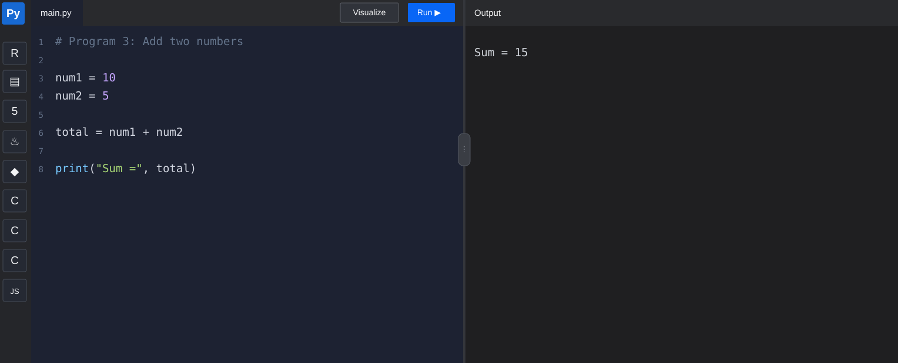
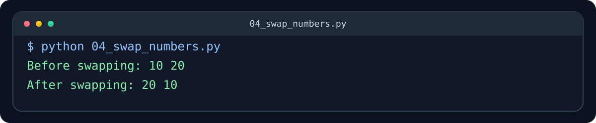
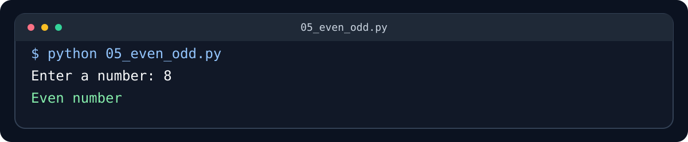
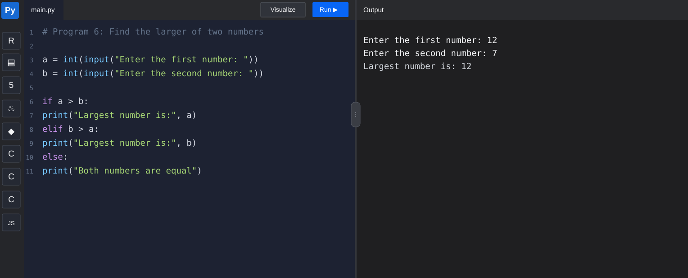
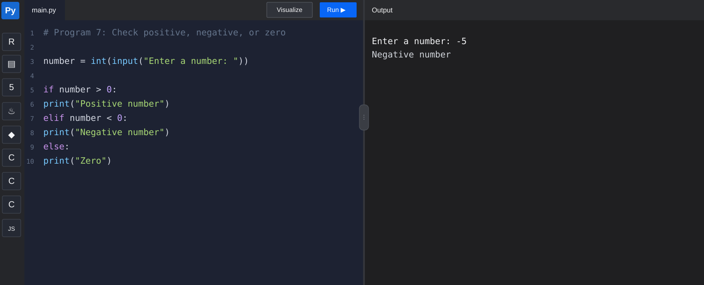
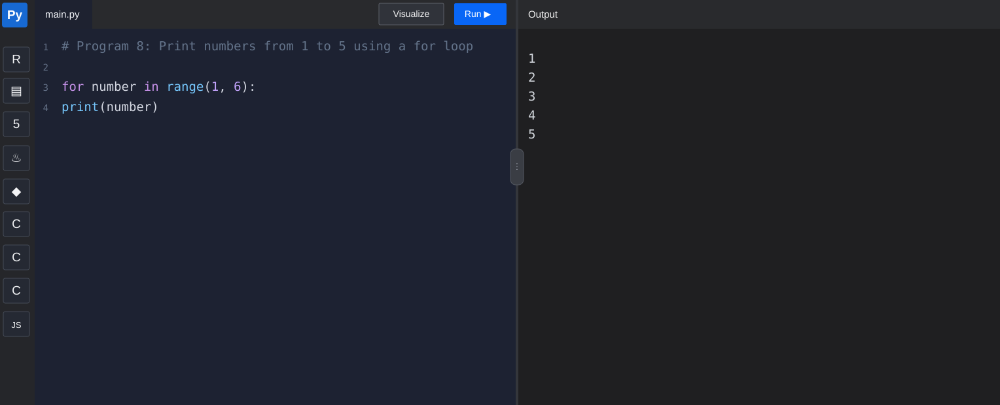
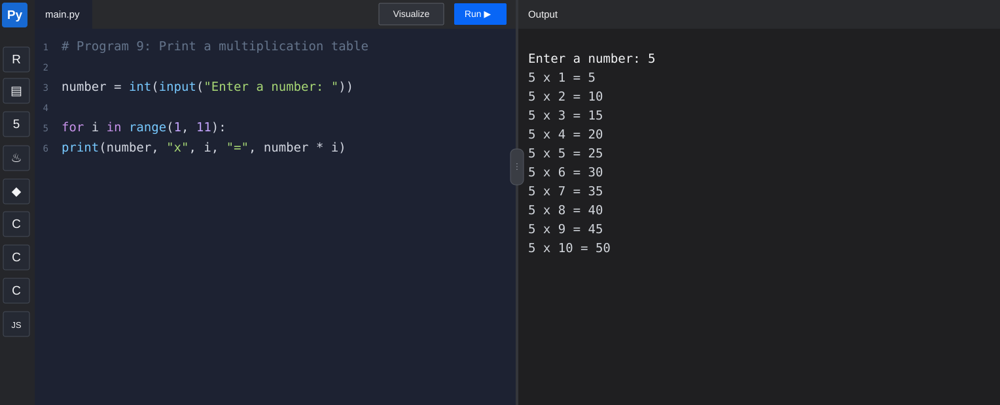
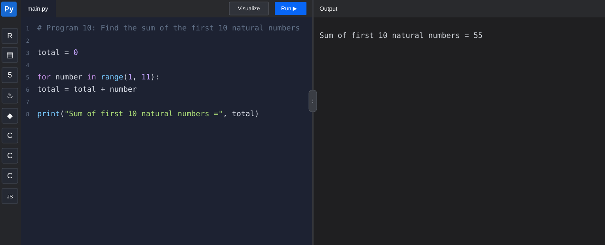

# Python Basic Programs

A beginner-friendly collection of 10 simple Python programs. Each program has a screenshot of its sample terminal output so learners can compare the code with the result.

## Programs

| No. | Program | Source code |
|---:|---|---|
| 1 | Hello, World! | [01_hello_world.py](01_hello_world.py) |
| 2 | Display name and age | [02_name_age.py](02_name_age.py) |
| 3 | Add two numbers | [03_add_two_numbers.py](03_add_two_numbers.py) |
| 4 | Swap two numbers | [04_swap_numbers.py](04_swap_numbers.py) |
| 5 | Check even or odd | [05_even_odd.py](05_even_odd.py) |
| 6 | Find the larger of two numbers | [06_largest_number.py](06_largest_number.py) |
| 7 | Check positive, negative, or zero | [07_positive_negative.py](07_positive_negative.py) |
| 8 | Print numbers with a for loop | [08_for_loop.py](08_for_loop.py) |
| 9 | Multiplication table | [09_multiplication_table.py](09_multiplication_table.py) |
| 10 | Sum of the first 10 natural numbers | [10_sum_first_10.py](10_sum_first_10.py) |

## Code and sample output screenshots

The screenshots below show sample runs. For programs that ask for input, the screenshot includes an example value typed by the user.

### 1. Hello, World!
Source: [01_hello_world.py](01_hello_world.py)



### 2. Display name and age
Source: [02_name_age.py](02_name_age.py)



### 3. Add two numbers
Source: [03_add_two_numbers.py](03_add_two_numbers.py)



### 4. Swap two numbers
Source: [04_swap_numbers.py](04_swap_numbers.py)



### 5. Check even or odd
Source: [05_even_odd.py](05_even_odd.py)



### 6. Find the larger of two numbers
Source: [06_largest_number.py](06_largest_number.py)



### 7. Check positive, negative, or zero
Source: [07_positive_negative.py](07_positive_negative.py)



### 8. Print numbers with a for loop
Source: [08_for_loop.py](08_for_loop.py)



### 9. Multiplication table
Source: [09_multiplication_table.py](09_multiplication_table.py)



### 10. Sum of the first 10 natural numbers
Source: [10_sum_first_10.py](10_sum_first_10.py)



## How to run

1. Install Python 3 from [python.org](https://www.python.org/) if it is not installed.
2. Download or clone this repository.
3. Open a terminal in the project folder.
4. Run a program, for example:

```bash
python 01_hello_world.py
```

On some systems, use `python3` instead of `python`.

These examples use basic Python syntax and require no extra packages.
